<h1>Self-Balancing Multi-Rotor Beam</h1>

The goal of this project was to build a self-balancing beam as a laboratory platform for testing and comparing control algorithms. A sensor measures the beam’s tilt angle, while two motor-driven propellers generate differential thrust to control its position.

The physical prototype makes it possible to observe and compare controller responses to reference-angle changes and external disturbances.

Developed as a bachelor’s thesis in Automatic Control and Robotics at Poznan University of Technology (2026).

<strong>Authors:</strong> Martyna Rydczak and Maciej Jaśtak <strong>Supervisor:</strong> dr inż. Bartłomiej Wicher

<strong>ESP32 · C++ · Python · MPU6050 · P/PI control</strong>

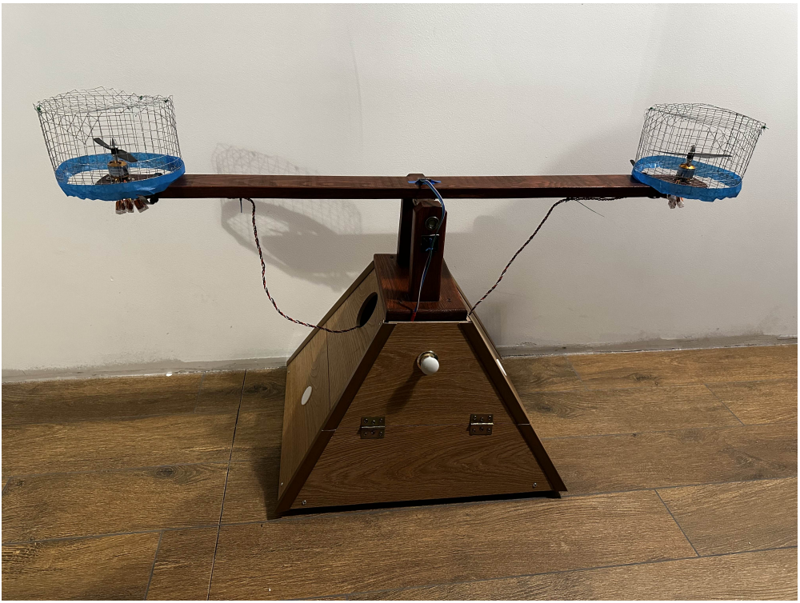

The physical prototype with both propulsion units and protective enclosures.

<h2>See it in action</h2>

<a href="media/recovery-pi.mp4"><strong>▶ Watch the PI recovery experiment (video)</strong></a>

Recovery after deflection — PI controller.

The ESP32 estimates beam angle from accelerometer measurements and adjusts both motor commands. A custom Python terminal allows live tuning and records measurements for analysis.

<blockquote><h2>My contribution · Martyna Rydczak</h2>

I was responsible for the electronics, propulsion integration, all software and experimental evaluation.

<strong>Hardware integration.</strong> I selected the electronic and propulsion components, assembled and wired the system, and mounted the motors, propellers and protective enclosures on the wooden beam structure. I integrated the MPU6050 sensor with the ESP32 and connected the controller to both ESCs.

<strong>Embedded software.</strong> I wrote the complete ESP32 firmware in C++. This included accelerometer-based angle estimation, startup offset calibration, low-pass filtering and the controller that generates differential motor commands. I implemented adjustable gains, individual motor trims, output limits and serial commands for operating and tuning the prototype.

<strong>Measurement and evaluation.</strong> I developed the Python terminal and logger to change settings during experiments and record the measured angle, reference angle, controller gains and motor commands. I tuned the P and PI controllers on the physical stand, carried out the tests, collected the data and prepared the plots used to compare their responses. I also created the electronic system and control architecture diagrams in vector graphics.

</blockquote>
<blockquote>
<strong>Maciej Jaśtak’s contribution</strong>

Maciej built the wooden support and beam structure and prepared the mathematical calculations for the joint thesis.
</blockquote>
<h2>How it works</h2>
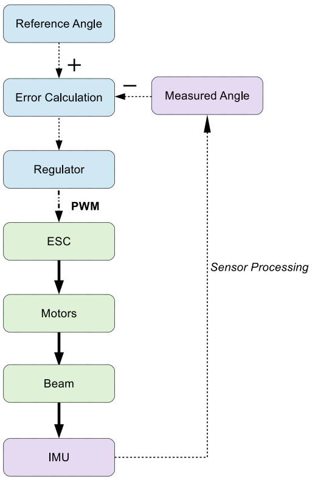<table><thead><tr><th>Arrow</th><th>Signal type</th></tr></thead><tbody><tr><td>····▶</td><td>Information signal</td></tr><tr><td>-·-·▶</td><td>PWM control signal</td></tr><tr><td>━━▶</td><td>Physical interaction</td></tr></tbody></table>
My control-loop diagram from the thesis presentation. The diagram uses reference minus measured angle; the firmware uses measured minus reference with corresponding motor output signs.

The firmware includes startup angle calibration, individual motor trims and adjustable controller gains. The reported experiments used P and PI control with <code>Kd = 0</code>.

<strong>Electronic system overview</strong>
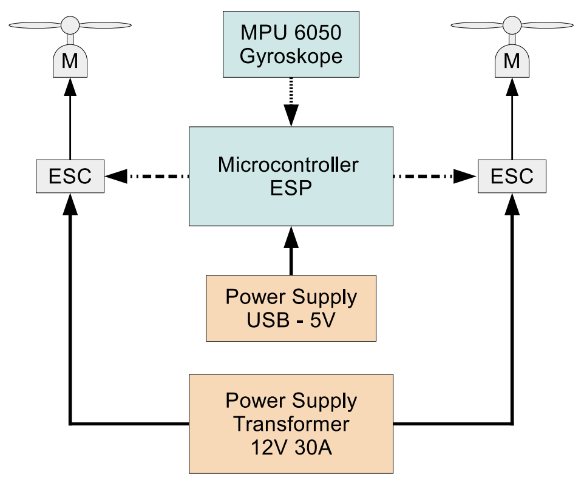<table><thead><tr><th>Arrow</th><th>Signal type</th></tr></thead><tbody><tr><td>━━▶</td><td>Constant supply voltage</td></tr><tr><td>──▶</td><td>Power signal</td></tr><tr><td>····▶</td><td>I²C digital data</td></tr><tr><td>-·-·▶</td><td>PWM control signal</td></tr></tbody></table>
My electronic system diagram. The MPU6050 label in the original illustration refers to the IMU module; angle estimation in the experiments used its accelerometer.

Electronic design · Connection schematics

I selected and connected the electronic components, integrating the ESP32, MPU6050 and both motor controllers. These schematic excerpts from the thesis presentation document the signal connections and propulsion wiring.

<table><tr><th>ESP32 connections</th><th>MPU6050 connections</th></tr><tr><td>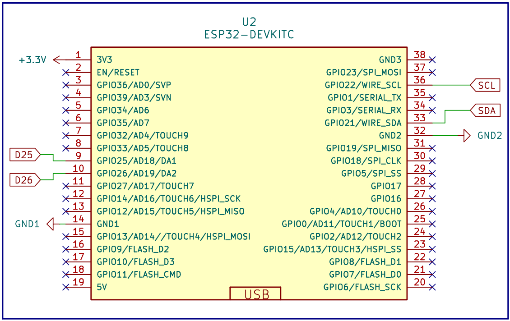</td><td>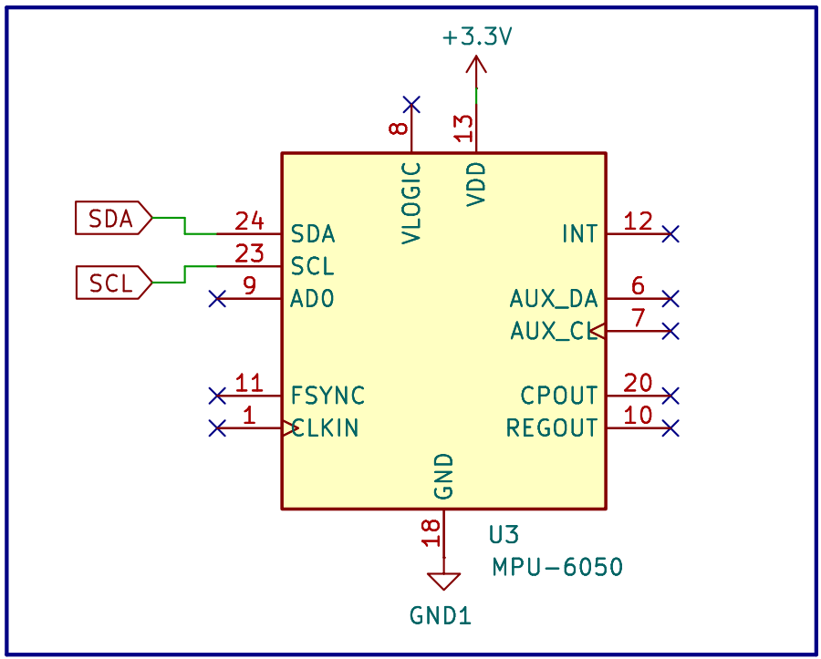</td></tr></table>

<strong>ESC and motor connections</strong>

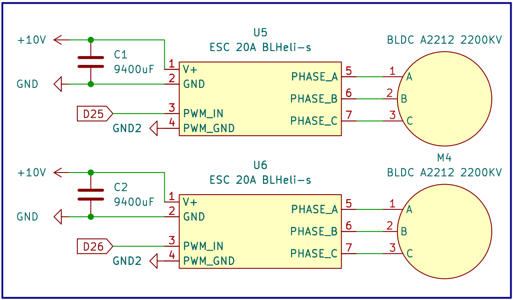

Schematic excerpts from the presentation; these do not constitute a complete wiring guide.

<h2>Experiments and results</h2>

I compared P and PI control on the physical prototype using three test scenarios. The recorded angle and motor commands showed how each controller responded to disturbances and changes in the reference.

<strong>Recovery after a large deflection.</strong> After manually deflecting and releasing the beam, both controllers returned it towards the horizontal reference. P control showed faster decay of the oscillations but retained a small steady-state offset. PI control removed the residual offset in the reported test, with a longer settling time.

<table><tr><th>P controller · Recovery after deflection</th><th>PI controller · Recovery after deflection</th></tr><tr><td>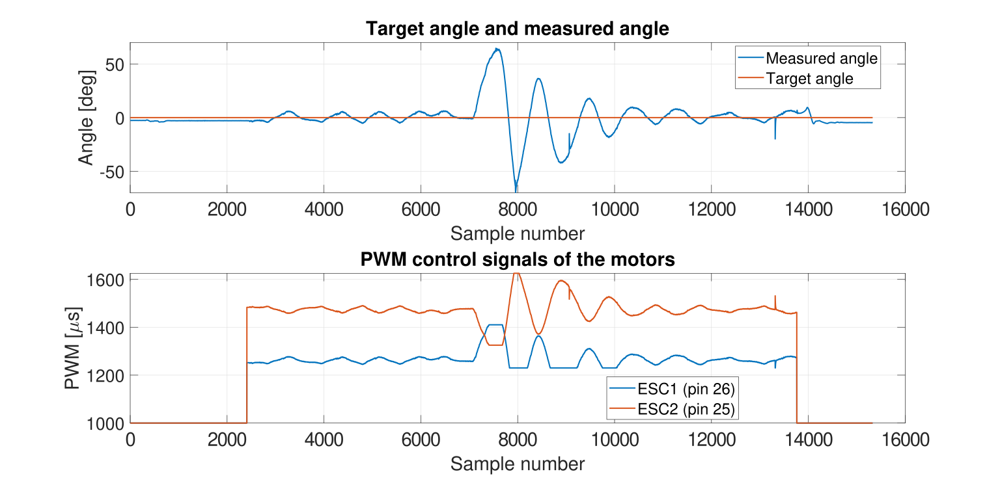</td><td>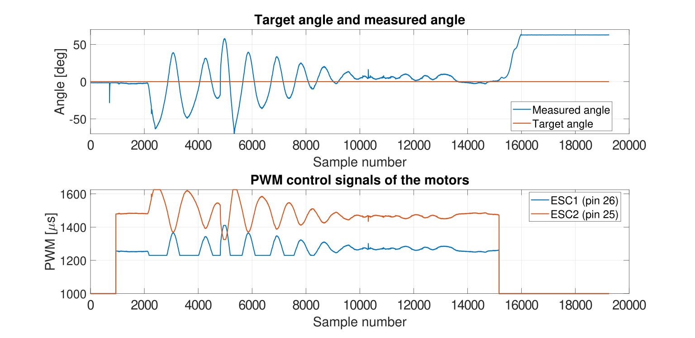</td></tr></table>

<strong>Ground-effect disturbance.</strong> Placing a flat surface below one rotor changed its thrust and disturbed the balance. With P control, a persistent deviation from the reference remained. With PI control, the deviation became a transient response and the beam returned towards the horizontal reference. The plots below illustrate this difference.

<table><tr><th>P controller · Ground effect</th><th>PI controller · Ground effect</th></tr><tr><td>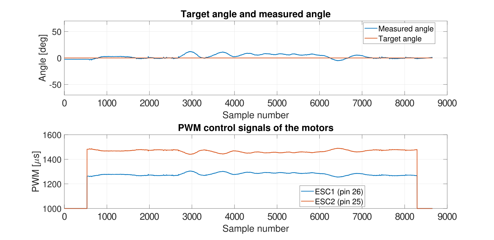</td><td>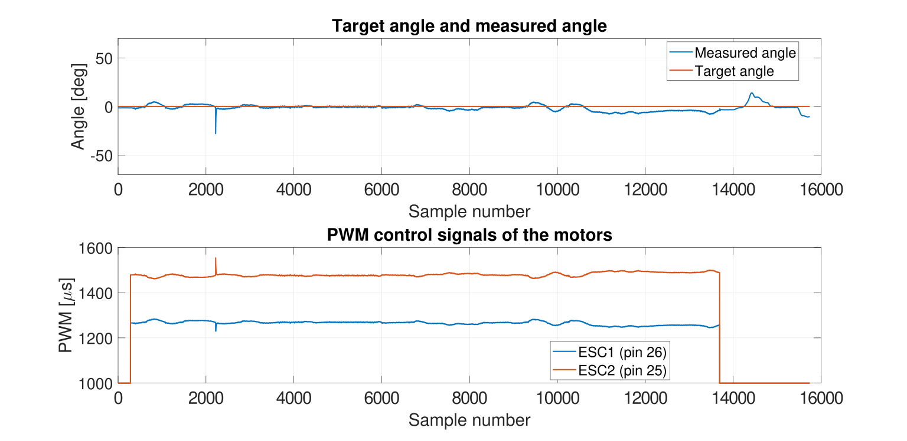</td></tr></table>

<strong>Reference-angle changes.</strong> The beam was commanded from 0° to +20°, back to 0°, then to −40° and back to 0°. P control followed the changes but retained tracking offsets and oscillations. PI control converged closer to the commanded angles, although transient oscillations remained after larger changes.

<table><tr><th>P controller · Reference-angle changes</th><th>PI controller · Reference-angle changes</th></tr><tr><td>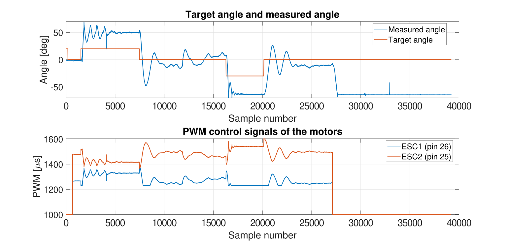</td><td>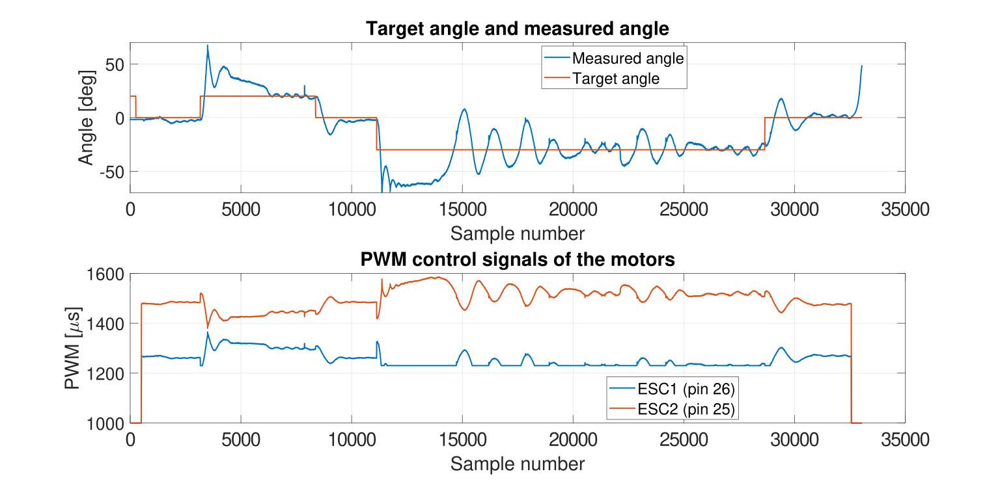</td></tr></table>

<strong>Actuator asymmetry.</strong> Equal PWM commands did not produce balanced operation of the two propulsion units. I compensated for this using individual trims of −105 µs and +125 µs. This improved equilibrium behaviour and highlighted the need to calibrate the physical actuators.

<strong>What the experiments showed.</strong> Integral action improved steady-state accuracy and rejection of a sustained disturbance, while P control recovered faster in the deflection test. Neither tested configuration provided sufficient damping throughout the experiments. Evaluating the existing derivative term is a potential next step; it was disabled during these tests.

Original plots use sample number on the horizontal axis.

Hardware and software
<ul><li>ESP32, MPU6050 and two A2212 2200KV brushless motors</li><li>Two BLHeli-S 20 A ESCs and EP-6030 propellers</li><li>Arduino firmware: Adafruit MPU6050, Adafruit Unified Sensor, ESP32Servo</li><li>Python terminal: pyserial and prompt_toolkit</li></ul>
Exact library versions were not recorded.

Running the project

Upload <code>Self-Balancing_Beam/Self-Balancing_Beam.ino</code> using an Arduino environment configured for the ESP32. Keep the beam horizontal during startup calibration.
<pre>python -m pip install pyserial prompt_toolkit
python Logger.py</pre>
Set the serial port in <code>Logger.py</code>. Communication uses 115200 baud. Send <code>x</code> before exiting: <code>quit</code> closes the terminal without stopping the motors.

Limitations and further development

Accelerometer angle estimation is affected by vibrations. Tuning and motor trims are specific to the prototype. Derivative control is implemented but was not evaluated in the reported experiments. Potential extensions include improved sensor estimation and automated test sequences.

